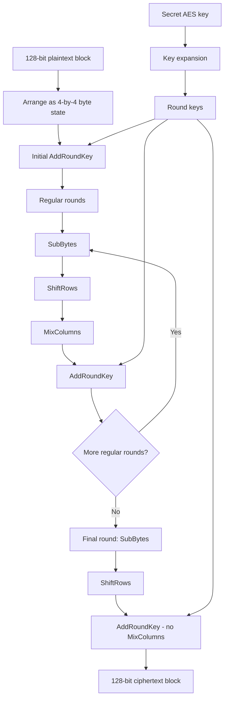
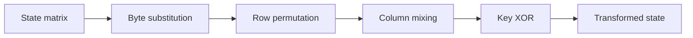
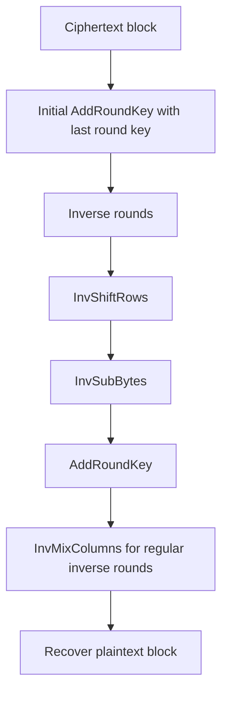
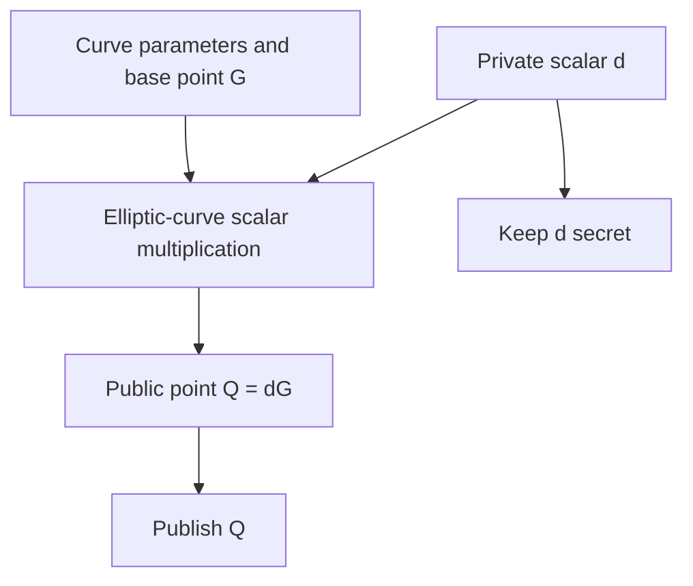
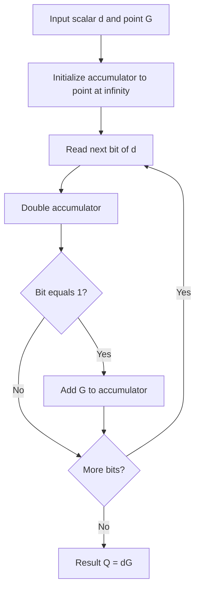
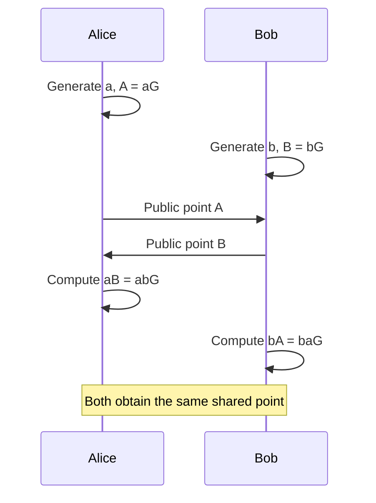

# CSE 406 — Computer Security Sessional

This repository covers two fundamental cryptographic algorithms: **Advanced Encryption Standard (AES)** for symmetric-key encryption and **Elliptic Curve Cryptography (ECC)** for public-key cryptography.

The explanations below describe the **standard algorithms**. The repository folder is publicly visible, but its source files and original diagrams could not be retrieved for verification; therefore, no particular AES key size or mode, elliptic curve, ECC encryption scheme, programming language, or execution command is claimed here.

## 1. Advanced Encryption Standard (AES)

AES is a symmetric-key block cipher: the same secret key is used to encrypt and decrypt a 128-bit block of data. Depending on key size, AES uses **10, 12, or 14 rounds** for 128-, 192-, or 256-bit keys, respectively.

### Encryption process

**Step 1 — State formation.** The 16 bytes of the plaintext block are arranged into a four-row, four-column state matrix.

**Step 2 — Key expansion.** Round keys are derived from the original secret key using AES's key-schedule procedure. The number of derived round keys depends on key size.

**Step 3 — Initial AddRoundKey.** Each state byte is XORed with the corresponding byte of the initial round key.

**Step 4 — Regular encryption rounds.** Each regular round applies four transformations:

1. **SubBytes:** apply a nonlinear S-box substitution to each byte.
2. **ShiftRows:** cyclically shift the state rows to different positions.
3. **MixColumns:** mix each column using arithmetic over the finite field GF(2^8).
4. **AddRoundKey:** XOR the state with the current round key.

**Step 5 — Final round.** Apply SubBytes, ShiftRows, and AddRoundKey, **omitting MixColumns**.

### AES state transformation

### Decryption process

AES decryption uses the same secret key, derives the round keys, and applies the inverse round transformations in the appropriate reverse order:

For messages longer than one AES block, a **block cipher mode** and any required IV/nonce/padding rules must also be specified. These details depend on the particular implementation.

---

## 2. Elliptic Curve Cryptography (ECC)

ECC uses arithmetic on points of an elliptic curve over a finite field. Its core operation is **scalar multiplication**: multiplying a public base point by a secret integer. This makes public keys easy to derive while recovering the private integer from a public point is computationally difficult for appropriately chosen curves and parameters.

### Mathematical foundation

For a short Weierstrass curve over a prime field, the curve is written as:

\[
y^2 \equiv x^3 + ax + b \pmod p
\]

The public parameters include a finite field, the curve coefficients, a base point **G**, and its order **n**.

### Key generation

1. Select a private scalar **d** from the permitted range, typically `1 <= d < n`.
2. Compute the public key point **Q = dG** using elliptic-curve scalar multiplication.
3. Keep **d** secret and distribute **Q** as the public key.

### How scalar multiplication works

Scalar multiplication is built from **point addition** and **point doubling**. A standard double-and-add procedure processes the bits of the private scalar, repeatedly doubling a point and conditionally adding the base point.

### ECC encryption and key agreement

**ECC itself is the mathematical foundation**, not one fixed encryption procedure. Actual applications may use elliptic-curve ElGamal, ECDH-based hybrid encryption, signatures, or another construction. To describe the repository's exact ECC encryption/decryption steps, its source code or project diagram needs to be checked.

A common *illustrative* use is Elliptic-Curve Diffie–Hellman (ECDH), in which two participants obtain the same shared curve point:

- Alice: private `a`, public `A = aG`.
- Bob: private `b`, public `B = bG`.
- Alice computes `aB = abG`.
- Bob computes `bA = baG`.

ECDH produces shared key material; a secure hybrid-encryption protocol additionally needs an appropriate **key-derivation function** and **authenticated encryption**. ECDH is included here for conceptual illustration, **not as a claim that this repository implements ECDH**.

---

## AES and ECC — Main Difference

| Property | AES | ECC |
|---|---|---|
| Cryptography type | Symmetric key | Public key |
| Fundamental operation | Substitution, permutation, finite-field mixing, key XOR | Elliptic-curve point operations and scalar multiplication |
| Keys | Shared secret key | Private/public key pair |
| Typical role | Encrypt bulk data | Key agreement, digital signatures, or public-key encryption constructions |

The two techniques can complement one another: ECC-based mechanisms may establish or protect a key, while AES encrypts the application data. Whether they are combined in this particular project must be confirmed from the implementation.
